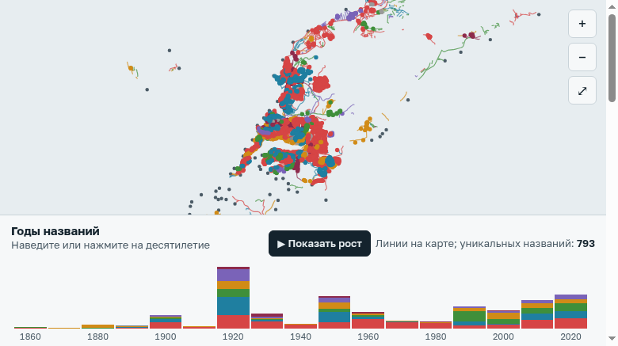
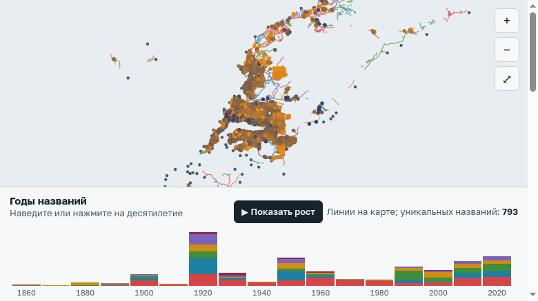
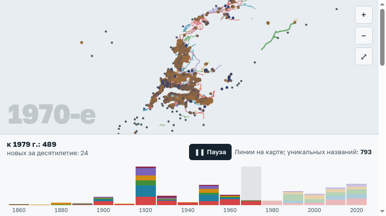

# Топонимика улиц Владивостока — интерактивная карта



Интерактивная **офлайн-карта одного файла**: 821 линия улиц Владивостока, раскрашенная по тематикам названий, таймлайн присвоения имён 1860–2020-е и слой **3 583 многоквартирных домов** (ФКР) с годами постройки. Без зависимостей и сборщиков — открыл HTML и работай.

## Возможности

- **Клик по улице** — почему так названа: группа → тематика → подтема, год присвоения и ссылка на первоисточник (`year_source`: постановления, справочник 1924 г., списки 1957 г.).
- **«Показать рост»** — анимация: улицы появляются по году названия, дома — по году постройки, плавно внутри каждого десятилетия; счётчики «к YYYY г.» тикают вживую.
- **Слой «Дома (год постройки)»**: сине-янтарная шкала по десятилетию или цвет по группе улицы (переключатель); клик по дому — адрес ФКР, год, материал стен, этажей; клик по улице — сводка по её домам (сколько, мин–макс год, топ-3 материала).
- Поиск улицы, родственная подсветка (та же подтема/тематика/группа), легенда, светлая/тёмная тема, зум колесом и щипком.
- Офлайн: единственный внешний запрос — Google Fonts при наличии сети.

## Скриншоты

| Дома по году (десятилетия постройки) | Анимация роста, 1979 год |
|---|---|
|  |  |

## Быстрый старт

Скачайте один файл и откройте в браузере: [`04_prototype/vladivostok-streets-map.html`](04_prototype/vladivostok-streets-map.html) (~745 КБ).

```bash
git clone https://github.com/fptf/vl-history.git
open vl-history/04_prototype/vladivostok-streets-map.html
```

## Пересборка из исходников

```bash
pip install -r 05_code/requirements.txt
bash 05_code/build.sh
```

Внутри: `classify.py` строит классификацию, `build.py` пишет xlsx, `houses_prep.py` готовит дома из `buildings/ФКР_дома_с_координатами.csv`, `prep.py` собирает `data.json` из geojson + домов, `assemble.py` подставляет данные в шаблон. Сборка воспроизводима бит-в-бит (допустимое расхождение — байты xlsx от openpyxl, ячейки идентичны). Промежуточные `rows.json`/`data.json`/`houses.json` в git не входят.

⚠️ Открывать в браузере нужно именно HTML-файл с диска: в предпросмотрах (Quick Look, мессенджеры, почта) JavaScript не выполняется и карта будет пустой.

## Данные и источники

| Слой | Источник | Условия |
|---|---|---|
| Геометрия улиц/мысов | © участники OpenStreetMap, проект [vvmap](https://github.com/skirienko/vvmap) | ODbL, атрибуция обязательна; у vvmap явной лицензии нет |
| Годы названий | [vvmap](https://github.com/skirienko/vvmap) (справочник 1924 г., списки 1957 г., постановления) | ссылка на первоисточник — у каждой линии |
| Классификация | авторская разметка + веб-исследование | URL-источник у каждого вердикта (`06_research/`) |
| Дома | [fkr25.ru](https://fkr25.ru) — ФКР Приморья, пост. № 513-па, ред. 30.04.2026 | координаты — автогеокодирование, не «официальные ФКР» |

Подробно: [DATASET.md](DATASET.md) · карта происхождения по файлам и полям: [`03_sources/provenance.md`](03_sources/provenance.md) · сырые выгрузки с контрольными суммами: [`03_sources/raw/MANIFEST.md`](03_sources/raw/MANIFEST.md) (`sha256sum -c 03_sources/raw/SHA256SUMS`).

## Состав репозитория

| Путь | Что это |
|---|---|
| `04_prototype/` | Готовая карта — один HTML-файл |
| `02_data/` | geojson-линии, классификация CSV/xlsx, сырые списки улиц и годов |
| `05_code/` | Скрипты сборки + шаблон карты (без данных) |
| `buildings/` | Дома ФКР с координатами (Владивостокский ГО) |
| `06_research/` | Две волны исследования 85 спорных названий: вердикты с URL |
| `docs/` | Скриншоты и [презентация проекта](docs/vl-history-presentation.html) (7 слайдов, QR и ссылки внутри) |
| `03_sources/` | Происхождение данных, сырые выгрузки, sha256-манифест |
| `CHANGELOG.md` | История изменений по датам (Владивосток, UTC+10) |

## Оговорки

- Год в данных — год **нынешнего названия** или первого упоминания, не год появления улицы; пик 1920-х во многом даёт справочник 1924 г.
- 821 линия ≠ 793 названия: улица может занимать несколько линий (24 названия повторяются); счётчики считают линии.
- Классификация авторская, 37 названий помечены «нужна проверка» (2 волны исследования закрыли 48 из 85).
- Дома без сопоставления с улицами карты (3,9 %) отображаются без привязки.

## Лицензии

Код — [MIT](LICENSE). Данные — разные условия: см. [DATASET.md](DATASET.md) (OSM ODbL / vvmap — уточнить у автора / fkr25.ru — публичные госданные, статус перепубликации не проверен).
